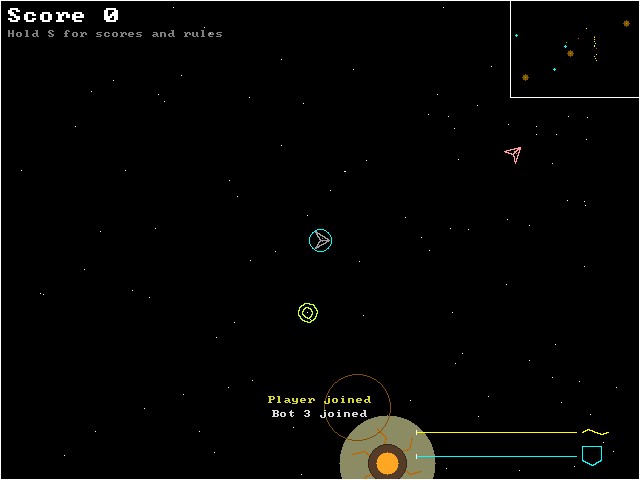
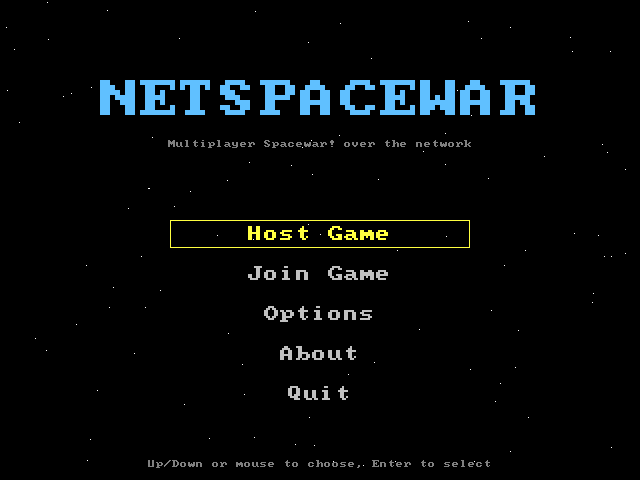
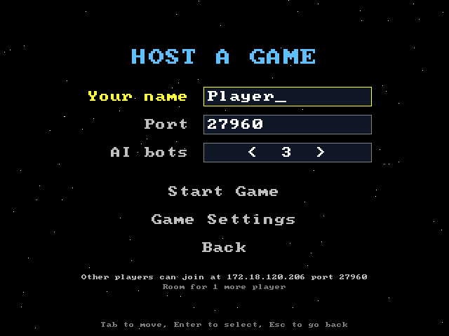
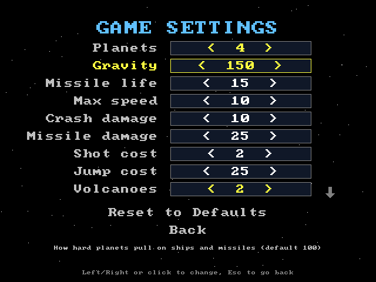
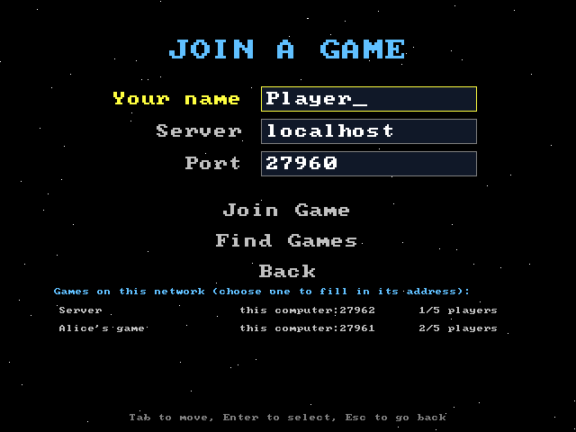

# NetSpaceWar
Network based Space War: a multiplayer clone of Spacewar! Fly around a looping universe, dodge planets, and shoot down other players and AI bots.



## Download

**Windows:** download `NetSpaceWar-<version>-setup.exe` from the [latest release](https://github.com/josephcolton/NetSpaceWar/releases/latest) and run it. The installer isn't code-signed, so if Windows SmartScreen says "Windows protected your PC", click **More info**, then **Run anyway**.

On Linux, build from source (below).

## Building

NetSpaceWar uses CMake. From the repository root:

```sh
cmake -S . -B build
cmake --build build
```

This builds three programs in `build/`:

| Program | What it is | Needs |
|---|---|---|
| `NetSpaceWar` | The game: menus and the game window | SDL3 (downloaded automatically) |
| `SpaceWarServer` | Game server | Nothing beyond a C compiler |
| `SpaceWarAI` | Computer-controlled player, no window | Nothing beyond a C compiler |

Keep all three in the same folder: the game starts the server and AI bots from its own folder when you host.

If SDL3 isn't installed, CMake downloads it and links it into the game, so players don't need to install anything. Building SDL3 on Linux needs the X11 and Wayland development headers. On Debian/Ubuntu:

```sh
sudo apt install build-essential cmake libx11-dev libxext-dev libxrandr-dev libxcursor-dev \
    libxi-dev libxss-dev libxkbcommon-dev libwayland-dev libegl1-mesa-dev
```

To build only the server and AI (for example on a headless machine), configure with `-DNSW_BUILD_CLIENT=OFF`.

### Windows

The Windows programs are built with MinGW-w64, cross-compiled from Linux (`sudo apt install mingw-w64`, or [llvm-mingw](https://github.com/mstorsjo/llvm-mingw)):

```sh
cmake -S . -B build-windows -DCMAKE_TOOLCHAIN_FILE=cmake/mingw-w64-x86_64.cmake
cmake --build build-windows
```

These builds link SDL3 and the C runtime statically, so each `.exe` runs on its own on Windows 10 and later. The network protocol is the same on every platform, so Linux and Windows players can join the same game.

Building natively on Windows with MSVC should also work through CMake, but it hasn't been tried yet.

### Windows installer

The installer is built natively on Windows with MinGW gcc, Ninja and CMake 3.27 or later on `PATH` (for example from Strawberry Perl), plus [Inno Setup 6](https://jrsoftware.org/isdl.php). One command configures, builds and packages a release in `build-release/`:

```sh
cmake --workflow --preset windows-release
```

This produces `build-release/NetSpaceWar-<version>-setup.exe`. It installs the game into Program Files and adds a Start menu shortcut and an uninstaller. Players can also choose a desktop shortcut and a Windows Firewall rule for hosting games. The version number comes from `project()` in `CMakeLists.txt`. The installer isn't code-signed, so Windows SmartScreen asks players to click **More info → Run anyway**.

The icon is drawn by `res/make_icon.py` (`python res/make_icon.py` rewrites `res/netspacewar.ico`).

## Playing

Run `NetSpaceWar` (on Windows, double-click `NetSpaceWar.exe`).

<p>
  
  
</p>

- **Host Game** starts a game on your computer. Choose your name, a port, and how many AI bots to add (up to 4; a game holds 5 ships). The screen shows the address other players can use to join. On Windows, allow the firewall prompt so they can reach you.
  - **Game Settings** changes the rules for games you host: number of planets, gravity, missile life, top speed, crash and missile damage, the energy cost of shots and hyperjumps, how many planets start with volcanoes, how long a volcano waits between recharge orbs, how often asteroids drift in (None to Frequent; None by default), and the match length (Endless by default, or first to 500, 1000 or 5000 points). The list scrolls. Changed values are highlighted, and **Reset to Defaults** puts them all back. Everyone who joins, bots included, gets the host's rules: players see them by holding S.
- **Join Game** connects to someone else's game by address and port. It also searches your local network and lists the games it finds (the host's name, address and players); choose one to fill in its address and port. **Find Games** searches again. Games running a different version are shown dimmed. Servers started with the address 0.0.0.0 answer searches on UDP port 27959.

<p>
  
  
</p>

Press Escape during a game to return to the menu. Your choices are remembered for next time.

### From the command line

The programs also run on their own, for example to keep a dedicated server running (from `build/`):

```sh
./SpaceWarServer 0.0.0.0 27960                 # listen on every network interface
./SpaceWarServer 0.0.0.0 27960 --planets 4 --gravity 150   # change the rules
./SpaceWarServer 0.0.0.0 27960 --verbose      # also print every packet (--silent: print nothing)
./SpaceWarAI     <server> <port> <name>         # add a bot
./NetSpaceWar    <server> <port> <name>         # join directly, skipping the menu
```

The server reports when players join and leave, and every death and respawn. Run `SpaceWarServer` with no arguments to list every rule option with its range and default.

The AI hunts the nearest ship, leads its shots, steers clear of planets, moves power between shields and energy, goes after recharge orbs when it is running low, dodges asteroids, and shoots them when no ship is in range. It plays under the same turn, thrust and fire limits as a human.

### Controls

| Key | Action |
|---|---|
| Left / Right arrow | Turn |
| Up arrow | Thrust |
| Space or Left Ctrl | Fire missile |
| Tab | Hyperjump (also respawns after you die) |
| Z | Move energy to shields |
| X | Move shields to energy |
| S (hold) | Show the scoreboard and the game rules |
| M | Turn sound and music off and on |
| Escape | Leave the game |

A gamepad works too, plugged in before or during a game:

| Gamepad | Action |
|---|---|
| Left stick or D-pad | Turn (the stick turns gradually) |
| Right trigger (ZR), B (Circle) or D-pad up | Thrust (the trigger is gradual) |
| A (Cross) | Fire missile; also respawns after you die |
| Y (Triangle) | Hyperjump (also respawns) |
| Left / right bumper (L / R) | Move energy to / from shields |
| Left trigger (ZL), Back or - (hold) | Show the scoreboard |
| Start or + (press twice) | Leave the game and go back to the menu |

Buttons follow the labels printed on your controller, so A is A whether it sits at the bottom (Xbox) or on the right (Nintendo); PlayStation's Cross, Circle and Triangle work as A, B and Y. In the menus, use the D-pad or left stick to move, A to choose and B to go back. A on a name or address field jumps to Start Game or Join Game. **Options** shows which gamepad is connected and its buttons. On the keyboard, Space also respawns.

The window can be resized; the game scales to fit.

### Rules

- Missiles cost 2 energy. Energy does not recharge on its own, but shields slowly do, so move power between them with Z and X.
- A missile hit takes 25 shields. Below zero shields, your ship explodes.
- Planets pull you in with gravity, and touching one does heavy damage.
- Some planets have volcanoes that shoot out recharge orbs. Fly into one to refill your energy and shields completely. An orb is pulled by gravity like everything else: some escape their planet and drift away, others fall back. A planet destroys any orb that hits it, and an uncollected orb blinks and fades after a minute. Each volcano has one orb out at a time and waits 30 seconds (by default) after it is gone before erupting again.
- If the host turns them on, asteroids drift in from off screen. They pull lightly with their own gravity and take 4 missile hits (at the default damage) to destroy: 10 points per hit and 100 for destroying one. Ramming one does heavy damage to both you and the asteroid, and finishing one off by ramming also scores 100, though it may destroy you too. An asteroid that hits a planet explodes, and may wake up a volcano there or put one out.
- The universe wraps around at the edges.
- Ships appear well clear of planets, asteroids and other ships when they join, respawn or hyperjump.
- With a match length set, the first player to reach the target score wins. Everyone sees the final rankings, and a new match starts 10 seconds later.
- Who destroyed whom, and who joined or left, appears at the bottom of the screen.
- Sound effects get quieter with distance and come from the side they happened on. **Options** on the main menu sets the sound and music volumes; they are saved and apply to every game you host or join.
- Scoring: 10 points for a hit, 100 for a kill, and -100 for dying (scores never go below 0). Hitting yourself scores nothing. Hold S to see everyone's score, kills and deaths; the scoreboard also appears while you wait to respawn.
